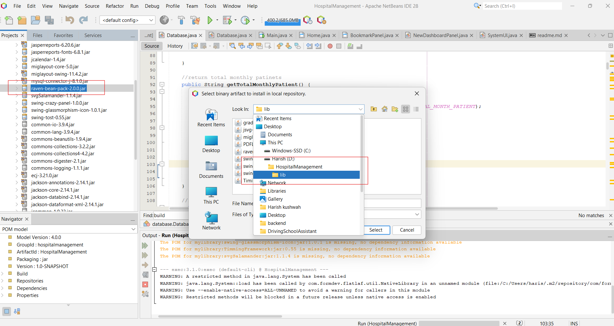
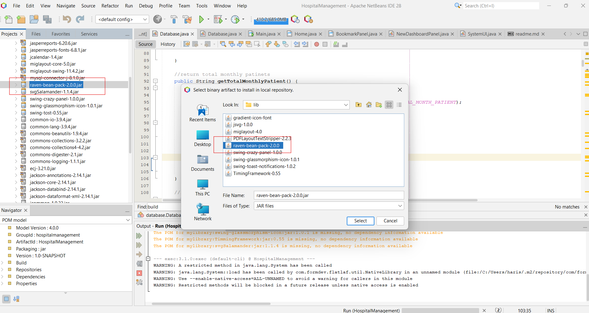
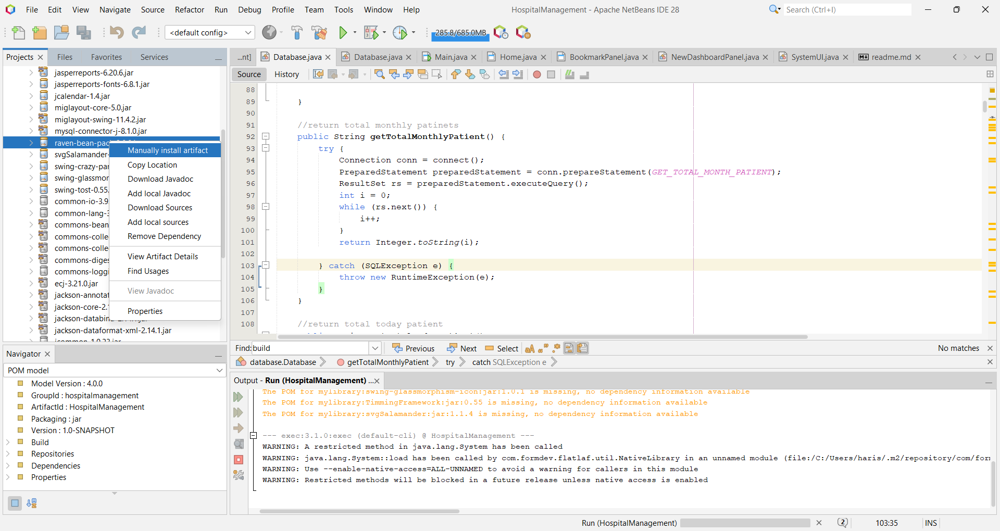
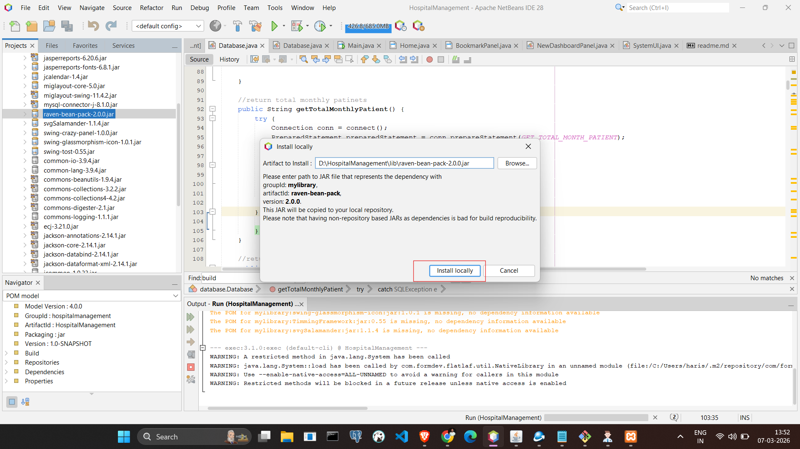
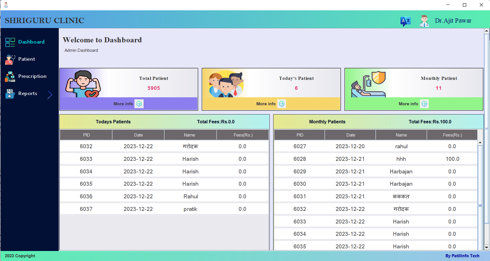
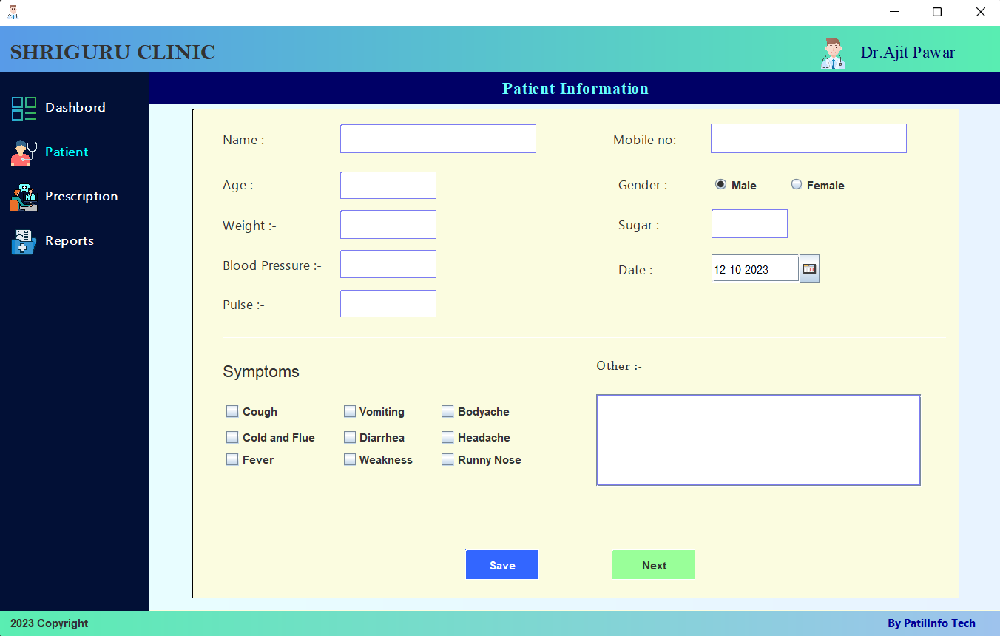
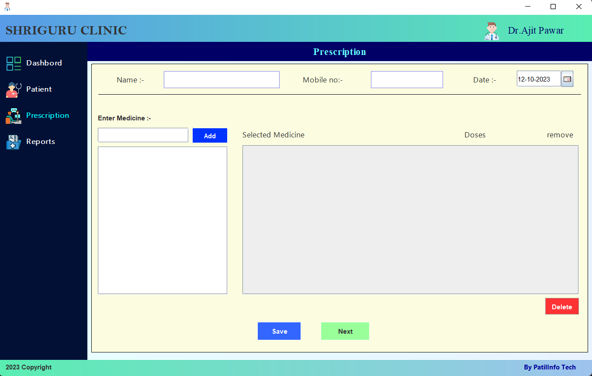
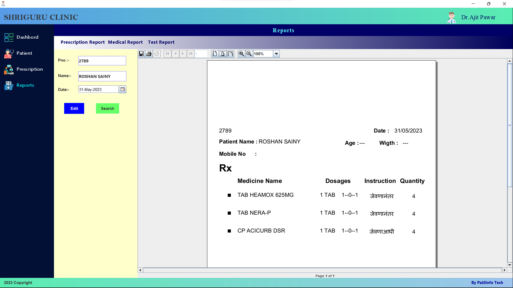
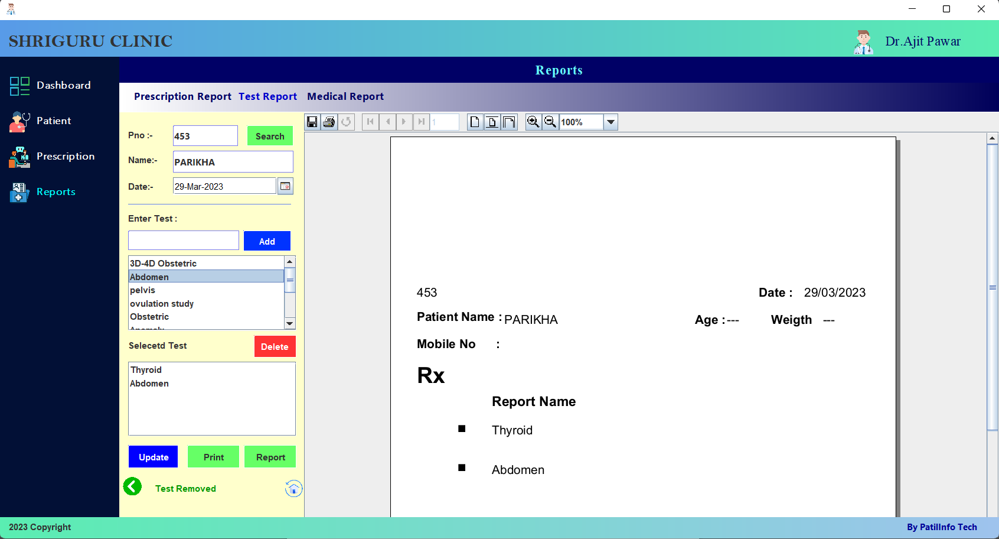
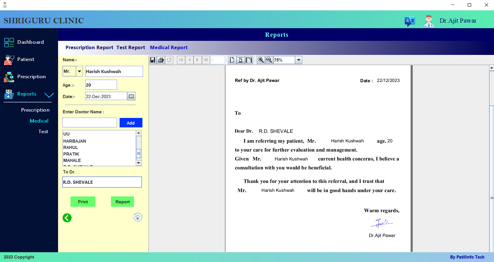

# 🏥 Hospital Management System — Setup, Build & Deployment Guide

> **Version:** 1.0
> **Author:** [Harish Kushwah](https://github.com/Harish-Kushwah)  
> **Publisher:** Patil Infotech

---

## Table of Contents

- [Prerequisites](#prerequisites)
- [1. Database Setup (MySQL)](#1-database-setup-mysql)
  - [1.1 Install MySQL](#11-install-mysql)
  - [1.2 Create the Database](#12-create-the-database)
  - [1.3 Configure Database Credentials](#13-configure-database-credentials)
- [2. Project Setup](#2-project-setup)
  - [2.1 Clone the Repository](#21-clone-the-repository)
  - [2.2 Install Custom Libraries to Local Maven Repository](#22-install-custom-libraries-to-local-maven-repository)
  - [2.3 Install Maven Dependencies](#23-install-maven-dependencies)
- [3. Run the Application](#3-run-the-application)
  - [3.1 Run from IDE (NetBeans)](#31-run-from-ide-netbeans)
  - [3.2 Run from Command Line (Maven)](#32-run-from-command-line-maven)
- [4. Build the Application JAR](#4-build-the-application-jar)
- [5. Create Windows Executable (.exe) with Launch4j](#5-create-windows-executable-exe-with-launch4j)
- [6. Create Windows Installer with Inno Setup](#6-create-windows-installer-with-inno-setup)
- [Database Schema Reference](#database-schema-reference)
- [Project Structure Overview](#project-structure-overview)
- [Troubleshooting](#troubleshooting)
- [External Resources](#external-resources)

---

## Prerequisites

Ensure the following software is installed on your system before proceeding:

| Software         | Minimum Version      | Download Link                                                                                                   |
| ---------------- | -------------------- | --------------------------------------------------------------------------------------------------------------- |
| **Java JDK**     | 17+                  | [Oracle JDK](https://www.oracle.com/java/technologies/javase-downloads.html) or [OpenJDK](https://openjdk.org/) |
| **Apache Maven** | 3.6+                 | [Maven Download](https://maven.apache.org/download.cgi)                                                         |
| **MySQL Server** | 5.7+ / MariaDB 10.4+ | [MySQL Download](https://dev.mysql.com/downloads/mysql/) or [XAMPP](https://www.apachefriends.org/)             |
| **Git**          | 2.0+                 | [Git Download](https://git-scm.com/downloads)                                                                   |
| **NetBeans IDE** | 12+ (optional)       | [NetBeans Download](https://netbeans.apache.org/download/)                                                      |

Verify installations:

```bash
java -version       # Should show 17 or higher
mvn -version         # Should show 3.6 or higher
mysql --version      # Should show 5.7+ or MariaDB 10.4+
git --version        # Should show 2.0+
```

---

## 1. Database Setup (MySQL)

### 1.1 Install MySQL

You can use either a standalone MySQL server or **XAMPP** (which bundles MySQL/MariaDB with phpMyAdmin).

- **XAMPP (Recommended for quick setup):** Download from [apachefriends.org](https://www.apachefriends.org/), install, and start the **MySQL** module from the XAMPP Control Panel.
- **Standalone MySQL:** Install MySQL Server and ensure it is running on `localhost:3306`.

### 1.2 Create the Database

The database SQL dump file is located at: `documentation/guru.sql`

#### Option A: Using MySQL Command Line

```bash
# Log in to MySQL
mysql -u root -p

# Create the database
CREATE DATABASE guru;

# Exit MySQL
exit;

# Import the schema and data
mysql -u root -p guru < documentation/guru.sql
```

#### Option B: Using phpMyAdmin (XAMPP)

1. Open phpMyAdmin at [http://localhost/phpmyadmin](http://localhost/phpmyadmin).
2. Click **"New"** in the left sidebar to create a new database.
3. Enter database name: `guru` and click **"Create"**.
4. Select the `guru` database, go to the **"Import"** tab.
5. Click **"Choose File"**, select `documentation/guru.sql`.
6. Click **"Go"** to execute the import.

#### Verify Database Tables

After import, the following **10 tables** should be created:

| Table               | Description                                   |
| ------------------- | --------------------------------------------- |
| `pdetail`           | Patient details (name, age, gender, BP, etc.) |
| `medi`              | Prescribed medicines for each patient         |
| `medilist`          | Master list of all available medicines        |
| `medicine_category` | Medicine category groupings                   |
| `bookmark`          | Saved prescription bookmarks/templates        |
| `patient_reports`   | Test/sonography reports linked to patients    |
| `reports`           | Master list of available report types         |
| `doctor_names`      | Registered doctor names                       |
| `email`             | Sent email records                            |
| `email_template`    | Email templates with subject and body         |

### 1.3 Configure Database Credentials

Open the database configuration file:

```
src/main/java/database/Database.java
```

Locate and update the following fields (around lines 16–18) to match your MySQL setup:

```java
private final String url = "jdbc:mysql://localhost/guru";
private final String user = "root";
private final String password = "";
```

| Field      | Default Value                 | Description                            |
| ---------- | ----------------------------- | -------------------------------------- |
| `url`      | `jdbc:mysql://localhost/guru` | JDBC URL — change host/port if needed  |
| `user`     | `root`                        | MySQL username                         |
| `password` | `""` (empty)                  | MySQL password — update if you set one |

> ⚠️ **Note:** If MySQL is running on a non-default port, update the URL accordingly:  
> `jdbc:mysql://localhost:3307/guru`

---

## 2. Project Setup

### 2.1 Clone the Repository

```bash
git clone https://github.com/Harish-Kushwah/HospitalManagement.git
cd HospitalManagement
```

### 2.2 Install Custom Libraries to Local Maven Repository

This project depends on several custom JAR libraries that are **not available on Maven Central**. They are stored in the `lib/` folder and must be installed into your local Maven repository.

#### Custom Library Mapping

| JAR File (in `lib/`)                  | Maven `artifactId`         | Maven `groupId` | Version |
| ------------------------------------- | -------------------------- | --------------- | ------- |
| `swing-toast-notifications-1.0.2.jar` | `swing-tost`               | `mylibrary`     | `0.55`  |
| `swing-glassmorphism-icon-1.0.1.jar`  | `swing-glassmorphism-icon` | `mylibrary`     | `1.0.1` |
| `swing-crazy-panel-1.0.0.jar`         | `swing-crazy-panel`        | `mylibrary`     | `1.0.0` |
| `raven-bean-pack-2.0.0.jar`           | `raven-bean-pack`          | `mylibrary`     | `2.0.0` |
| `jsvg-1.0.0.jar`                      | `svgSalamander`            | `mylibrary`     | `1.1.4` |
| `gradient-icon-font.jar`              | `gradient-icon-font`       | `mylibrary`     | `1.0`   |
| `TimingFramework-0.55.jar`            | `TimmingFramework`         | `mylibrary`     | `0.55`  |

#### Install Commands

Run the following commands from the project root directory to install each JAR into your local Maven repository (`~/.m2/repository`):

```bash
mvn install:install-file -Dfile=lib/swing-toast-notifications-1.0.2.jar -DgroupId=mylibrary -DartifactId=swing-tost -Dversion=0.55 -Dpackaging=jar

mvn install:install-file -Dfile=lib/swing-glassmorphism-icon-1.0.1.jar -DgroupId=mylibrary -DartifactId=swing-glassmorphism-icon -Dversion=1.0.1 -Dpackaging=jar

mvn install:install-file -Dfile=lib/swing-crazy-panel-1.0.0.jar -DgroupId=mylibrary -DartifactId=swing-crazy-panel -Dversion=1.0.0 -Dpackaging=jar

mvn install:install-file -Dfile=lib/raven-bean-pack-2.0.0.jar -DgroupId=mylibrary -DartifactId=raven-bean-pack -Dversion=2.0.0 -Dpackaging=jar

mvn install:install-file -Dfile=lib/jsvg-1.0.0.jar -DgroupId=mylibrary -DartifactId=svgSalamander -Dversion=1.1.4 -Dpackaging=jar

mvn install:install-file -Dfile=lib/gradient-icon-font.jar -DgroupId=mylibrary -DartifactId=gradient-icon-font -Dversion=1.0 -Dpackaging=jar

mvn install:install-file -Dfile=lib/TimingFramework-0.55.jar -DgroupId=mylibrary -DartifactId=TimmingFramework -Dversion=0.55 -Dpackaging=jar
```

#### NetBeans Alternative (GUI Method)

If using NetBeans IDE, you can install custom libraries through the GUI:

1. Navigate to the `lib/` folder of the project.

   

2. Select the dependency JAR file.

   

3. Right-click on the dependency JAR file.

   

4. Click **"Install Locally"**.

   

5. Repeat for each JAR file.

### 2.3 Install Maven Dependencies

After installing the custom libraries, resolve all Maven dependencies:

```bash
mvn clean install -DskipTests
```

This will download all remaining dependencies from Maven Central:

| Dependency             | Version  | Purpose                             |
| ---------------------- | -------- | ----------------------------------- |
| `mysql-connector-j`    | `8.1.0`  | MySQL JDBC driver                   |
| `jasperreports`        | `6.20.6` | PDF report generation               |
| `jasperreports-fonts`  | `6.8.1`  | Font support for reports            |
| `flatlaf`              | `3.4.1`  | Modern Flat look-and-feel for Swing |
| `flatlaf-extras`       | `3.4.1`  | FlatLaf additional components       |
| `flatlaf-fonts-roboto` | `2.137`  | Roboto font for FlatLaf             |
| `jcalendar`            | `1.4`    | Date picker component               |
| `miglayout-core`       | `5.0`    | MigLayout layout manager            |
| `miglayout-swing`      | `11.4.2` | MigLayout Swing bindings            |
| `common-image`         | `3.9.4`  | TwelveMonkeys image I/O             |

---

## 3. Run the Application

### 3.1 Run from IDE (NetBeans)

1. Open the project in **NetBeans IDE**.
2. Right-click on the project → **"Run"** (or press `F6`).
3. NetBeans will use the `nbactions.xml` configuration which executes:
   - `process-classes`
   - `exec-maven-plugin` with main class `hospitalmanagement.Main`

### 3.2 Run from Command Line (Maven)

```bash
mvn clean compile exec:java -Dexec.mainClass="hospitalmanagement.Main"
```

> **Main Entry Point:** `hospitalmanagement.Main`  
> The splash screen will load first, followed by the `Home` dashboard.

### Application Screenshots

**Dashboard**



**Patient Management**



**Prescription Management**



**Prescription Report**



**Test Report**



**Medical Report**



---

## 4. Build the Application JAR

The project uses the **Maven Shade Plugin** to create a fat JAR (JAR with all dependencies bundled).

### Step 1: Build the Fat JAR

Using Maven CLI:

```bash
mvn clean package
```

Or using the NetBeans custom action:

1. Open NetBeans → Right-click the project.
2. Select **"Custom"** → **"build myproject"**.
3. This runs the goals: `clean` → `package`.

### Step 2: Locate the Output JAR

After a successful build, the JAR file will be located at:

```
target/HospitalManagement-1.0-SNAPSHOT-jar-with-dependencies.jar
```

### Step 3: Test the JAR

```bash
java -jar target/HospitalManagement-1.0-SNAPSHOT-jar-with-dependencies.jar
```

> ⚠️ **Important:** The application expects `images/` and `report/` folders to be in the working directory. Always run the JAR from the project root, or ensure those folders are placed alongside the JAR.

---

## 5. Create Windows Executable (.exe) with Launch4j

[Launch4j](http://launch4j.sourceforge.net/) wraps the Java JAR into a native Windows `.exe` file.

### Prerequisites

- Download and install **Launch4j** from [launch4j.sourceforge.net](http://launch4j.sourceforge.net/).

### Step-by-Step Instructions

1. **Prepare a setup folder** on your desktop (e.g., `C:\Users\<user>\Desktop\ShriGuruClinic\`).

2. **Copy the following** from the project into the setup folder:

   - `target/HospitalManagement-1.0-SNAPSHOT-jar-with-dependencies.jar`
   - `images/` folder (application icons and assets)
   - `report/` folder (JasperReport `.jrxml` templates)
   - A Java JDK/JRE (to bundle with the exe, removing the need for users to install Java)

3. **Open Launch4j** and load the configuration file:

   ```
   documentation/Launch4j-config-file.xml
   ```

4. **Update paths** in the Launch4j configuration:

   | Field        | Description                                        | Example Value                                                                                             |
   | ------------ | -------------------------------------------------- | --------------------------------------------------------------------------------------------------------- |
   | **Jar**      | Path to the fat JAR                                | `C:\Users\<user>\Desktop\ShriGuruClinic\target\HospitalManagement-1.0-SNAPSHOT-jar-with-dependencies.jar` |
   | **Output**   | Path for the generated `.exe`                      | `C:\Users\<user>\Desktop\ShriGuruClinic\app-v7.0.0.exe`                                                   |
   | **Icon**     | `.ico` file for the application icon               | `C:\Users\<user>\Desktop\ShriGuruClinic\images\clinic_png_ico.ico`                                        |
   | **JRE Path** | Set to `jar` to use bundled JDK from JAR directory | `jar`                                                                                                     |

5. **Key Launch4j Settings:**

   | Setting          | Value    |
   | ---------------- | -------- |
   | Header Type      | `GUI`    |
   | Don't Wrap JAR   | `false`  |
   | Change Dir       | `.`      |
   | Priority         | `normal` |
   | Stay Alive       | `false`  |
   | Restart on Crash | `false`  |
   | Requires JDK     | `false`  |
   | Requires 64-Bit  | `false`  |

6. **Click the Build (gear) icon** to generate the `.exe` file.

> 📺 **Video Tutorial:** [How to use Launch4j](https://youtu.be/LpbQ-oTLsu0?si=una57Wh0XibeTfjI)

---

## 6. Create Windows Installer with Inno Setup

[Inno Setup](https://jrsoftware.org/isinfo.php) creates a professional Windows installer (`.exe` setup wizard).

### Prerequisites

- Download and install **Inno Setup** from [jrsoftware.org/isinfo.php](https://jrsoftware.org/isinfo.php).

### Step-by-Step Instructions

1. **Ensure the setup folder** (from Step 5) contains:

   ```
   ShriGuruClinic/
   ├── app.exe                  (renamed from app-v7.0.0.exe or as configured)
   ├── images/                  (application images)
   ├── report/                  (JasperReport templates)
   ├── jar/                     (bundled JDK — if using embedded JRE)
   ├── setup_icon.ico           (installer icon)
   └── ...
   ```

2. **Open Inno Setup Compiler** and load the configuration file:

   ```
   documentation/exe_to_installer_makup_inno_config.iss
   ```

3. **Update paths** in the `.iss` script:

   | Variable             | Description                             | Default Value                                           |
   | -------------------- | --------------------------------------- | ------------------------------------------------------- |
   | `MyAppName`          | Application display name                | `Shriguru Clinic`                                       |
   | `MyAppVersion`       | Application version                     | `7.0.1`                                                 |
   | `MyAppPublisher`     | Publisher name                          | `Patil Infotech`                                        |
   | `MyAppExeName`       | Executable filename                     | `app.exe`                                               |
   | `SetupIconFile`      | Path to the installer icon (`.ico`)     | `C:\Users\<user>\Desktop\ShriGuruClinic\setup_icon.ico` |
   | `OutputBaseFilename` | Name of the generated installer         | `version7.0.0`                                          |
   | `Source` (Files)     | Path to the application files to bundle | `C:\Users\<user>\Desktop\ShriGuruClinic\*`              |

4. **Key Installer Settings:**

   | Setting             | Value            | Description                          |
   | ------------------- | ---------------- | ------------------------------------ |
   | Install Directory   | `{autopf}\<App>` | Installs to Program Files            |
   | Compression         | `lzma`           | High compression ratio               |
   | Solid Compression   | `yes`            | Better compression for similar files |
   | Wizard Style        | `modern`         | Modern installer UI                  |
   | Desktop Icon        | Optional         | User can opt-in during install       |
   | Post-Install Launch | Yes              | Option to launch app after install   |

5. **Compile the script:**
   - Click **"Compile"** (or press `Ctrl+F9`) in Inno Setup Compiler.
   - The installer will be generated in the **Output** directory.

> 📺 **Video Tutorial:** [How to use Inno Setup](https://youtu.be/l1p2GQxcP54?si=6wuyuJ65__vzPyj4)

---

## Database Schema Reference

### Entity Relationship Diagram (Conceptual)

```
┌──────────────┐       ┌──────────────┐       ┌──────────────────┐
│   pdetail    │ 1───* │     medi     │       │     medilist     │
│ (patients)   │       │ (prescribed  │       │ (medicine master │
│              │       │  medicines)  │       │       list)      │
│  PK: pno     │       │  FK: pno     │       │  PK: medino      │
└──────┬───────┘       └──────────────┘       └──────────────────┘
       │
       │ 1───*  ┌──────────────────┐       ┌──────────────────┐
       └────────│ patient_reports  │  *──1 │     reports      │
                │ (patient test    │       │ (report type     │
                │    reports)      │       │   master list)   │
                │  FK: patient_no  │       │  PK: report_no   │
                └──────────────────┘       └──────────────────┘

┌──────────────┐       ┌──────────────────┐
│   bookmark   │       │ medicine_category│
│ (prescription│       │ (medicine groups)│
│  templates)  │       │                  │
│  PK: bno     │       │  PK: catno       │
└──────────────┘       └──────────────────┘

┌──────────────┐       ┌──────────────────┐
│ doctor_names │       │      email       │
│              │       │ (sent emails)    │
│  PK: doc_id  │       │  PK: email_id    │
└──────────────┘       └──────────────────┘

                       ┌──────────────────┐
                       │  email_template  │
                       │ (email templates)│
                       │  PK: email_id    │
                       └──────────────────┘
```

### Table Details

#### `pdetail` — Patient Details

| Column      | Type           | Description       |
| ----------- | -------------- | ----------------- |
| `pno`       | `int(5)` PK    | Patient number    |
| `date`      | `datetime`     | Registration date |
| `name`      | `varchar(50)`  | Patient name      |
| `mno`       | `varchar(10)`  | Mobile number     |
| `gen`       | `text`         | Gender            |
| `age`       | `int(3)`       | Age               |
| `wht`       | `int(3)`       | Weight            |
| `bp`        | `text`         | Blood pressure    |
| `pls`       | `varchar(3)`   | Pulse             |
| `pdis`      | `text`         | Diseases/symptoms |
| `fees_paid` | `float`        | Fees paid         |
| `email`     | `varchar(200)` | Patient email     |

#### `medi` — Prescribed Medicines

| Column    | Type          | Description                         |
| --------- | ------------- | ----------------------------------- |
| `pno`     | `int(10)` FK  | Patient number (references pdetail) |
| `pname`   | `varchar(50)` | Patient name                        |
| `medicin` | `varchar(50)` | Medicine name                       |
| `mqty`    | `varchar(10)` | Quantity (e.g., "1 TAB")            |
| `mtime`   | `varchar(30)` | Timing (e.g., "1--0--1")            |
| `ba`      | `int(1)`      | Before/After food flag              |
| `qty`     | `int(3)`      | Number of days                      |

#### `bookmark` — Prescription Templates

| Column    | Type          | Description                  |
| --------- | ------------- | ---------------------------- |
| `bno`     | `int(10)` PK  | Bookmark number              |
| `bname`   | `varchar(20)` | Bookmark name (e.g., "cold") |
| `medicin` | `varchar(50)` | Medicine name                |
| `mqty`    | `varchar(10)` | Quantity                     |
| `mtime`   | `varchar(30)` | Timing                       |
| `ba`      | `int(1)`      | Before/After food            |
| `qty`     | `int(3)`      | Number of days               |

---

## Project Structure Overview

```
HospitalManagement/
├── pom.xml                          # Maven build configuration
├── nbactions.xml                    # NetBeans custom build actions
├── readme.md                        # Project overview
├── contribute.md                    # Contribution guidelines
│
├── src/main/java/
│   ├── hospitalmanagement/
│   │   └── Main.java               # 🚀 Application entry point (splash screen)
│   ├── database/
│   │   └── Database.java           # 🗄️ Database connection (Singleton pattern)
│   ├── pages/
│   │   ├── Home.java               # 🏠 Main dashboard
│   │   ├── SearchPatient.java      # 🔍 Patient search
│   │   ├── BookmarkPanel.java      # 🔖 Prescription bookmarks
│   │   ├── MedicineCategory.java   # 💊 Medicine categories
│   │   └── NewDashboardPanel.java  # 📊 Dashboard statistics
│   ├── model/
│   │   ├── PatientDetails.java     # Patient data model
│   │   ├── ReportInfomartion.java  # Report data model
│   │   └── BooksPanelInfo.java     # Bookmark panel model
│   ├── medcine/
│   │   ├── MedicineDetails.java    # Medicine data model
│   │   ├── MedicineDetailsPanel.java
│   │   ├── MedicineRowPanel.java
│   │   └── MedicinePanelShortCutKey.java
│   ├── reports/                     # Report generation panels
│   ├── util/                        # Utility and custom Swing components
│   ├── myutil/                      # Input validation, image utilities
│   └── javaswingdev/                # Custom Swing UI framework
│
├── report/                          # 📄 JasperReport templates (.jrxml)
│   ├── prescription_report_with_sign.jrxml
│   ├── medical_report_with_sign.jrxml
│   ├── medical_certificate_with_sign.jrxml
│   └── test_report_with_sign.jrxml
│
├── images/                          # 🖼️ Application icons and images
├── lib/                             # 📦 Custom JAR libraries
├── logs/                            # 📝 Application logs
├── documentation/                   # 📚 Setup docs, SQL, configs
│   ├── guru.sql                     # Database schema + seed data
│   ├── Launch4j-config-file.xml     # Launch4j .exe wrapper config
│   ├── exe_to_installer_makup_inno_config.iss  # Inno Setup config
│   └── custome-library-mapping/     # Screenshots for library setup
└── META-INF/
    └── MANIFEST.MF                  # JAR manifest (Main-Class)
```

---

## Troubleshooting

### ❌ Maven Build Fails — "Could not find artifact mylibrary:..."

**Cause:** Custom libraries have not been installed to the local Maven repository.

**Fix:** Run all `mvn install:install-file` commands from [Section 2.2](#22-install-custom-libraries-to-local-maven-repository).

---

### ❌ Application Starts But Shows Database Error

**Cause:** MySQL is not running, or the credentials in `Database.java` are incorrect.

**Fix:**

1. Ensure MySQL/MariaDB service is running.
2. Verify the database `guru` exists.
3. Check credentials in `src/main/java/database/Database.java`.

---

### ❌ Reports Not Generating / JasperReport Errors

**Cause:** The `report/` folder is not accessible from the application's working directory.

**Fix:** Ensure you run the application from the project root directory, or copy the `report/` folder to the same location as the JAR/EXE.

---

### ❌ Images Not Loading

**Cause:** The `images/` folder is not found relative to the application's working directory.

**Fix:** Same as above — ensure the `images/` folder is in the working directory.

---

### ❌ "ClassNotFoundException" for MySQL Driver

**Cause:** The MySQL Connector JAR is not in the classpath.

**Fix:** Run `mvn clean install` to ensure all dependencies are resolved, or verify `mysql-connector-j` is in `pom.xml`.

---

## External Resources

| Resource                    | Link                                                                                                 |
| --------------------------- | ---------------------------------------------------------------------------------------------------- |
| **Launch4j Tutorial**       | [YouTube — How to use Launch4j](https://youtu.be/LpbQ-oTLsu0?si=una57Wh0XibeTfjI)                    |
| **Inno Setup Tutorial**     | [YouTube — How to use Inno Setup](https://youtu.be/l1p2GQxcP54?si=6wuyuJ65__vzPyj4)                  |
| **Maven Documentation**     | [maven.apache.org](https://maven.apache.org/)                                                        |
| **FlatLaf Look and Feel**   | [github.com/JFormDesigner/FlatLaf](https://github.com/JFormDesigner/FlatLaf)                         |
| **JasperReports Community** | [community.jaspersoft.com](https://community.jaspersoft.com/)                                        |
| **Project Repository**      | [github.com/Harish-Kushwah/HospitalManagement](https://github.com/Harish-Kushwah/HospitalManagement) |
